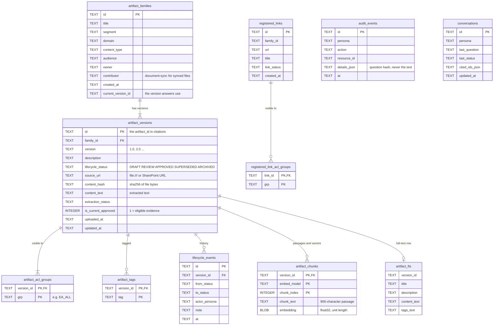
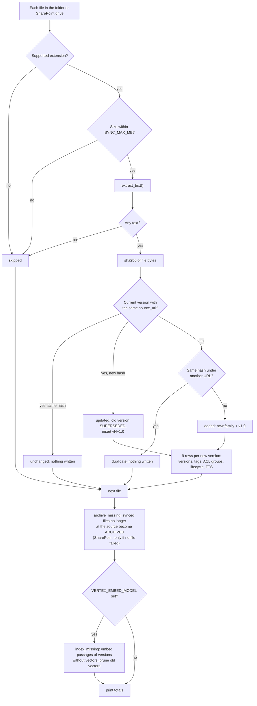
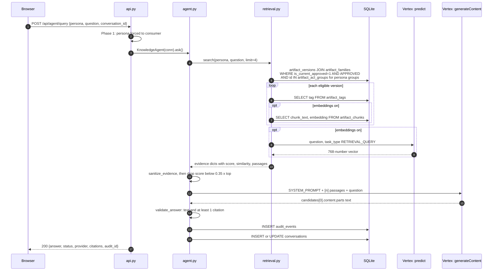
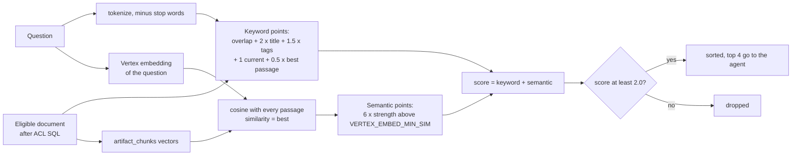
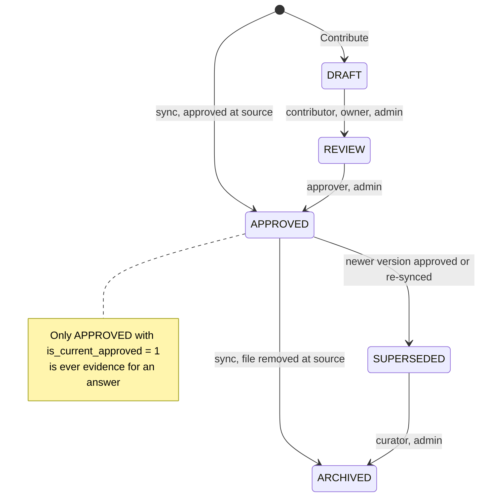

# Data Flow Deep Dive — tables, columns, SQL, transformations, API

This document traces each flow at column level. For each one it shows:
- **API:** the request and the response
- **Reads:** which table and column are read
- **Transformations:** how the data changes
- **Writes:** which table and column are written

The SQL is quoted from the code, so you can run the same queries in
DB Browser.

---

## 0. Data model

### 0.1 How the tables relate



`audit_events` and `conversations` are not linked by foreign keys:
`resource_id` and `cited_ids_json` hold version ids as plain text.

### 0.2 Conventions an architect will ask about

| Topic | Convention |
|---|---|
| IDs | `uuid4().hex`, 32 hexadecimal characters, stored as TEXT |
| "artifact_id" in the API | Always means **`artifact_versions.id`**, a *version* id, not a family id |
| Timestamps | ISO-8601 UTC strings, e.g. `2026-11-04T09:15:02+00:00` |
| Booleans | INTEGER 0/1 (`is_current_approved`) |
| Tags, segment, domain, audience | Upper-cased on write |
| History | Never overwritten. A new version is a new row, and old rows change only their status |
| Foreign keys | `PRAGMA foreign_keys = ON` on every connection |
| The "one current version per family" rule | Enforced **in code** (`ingest._supersede`, `repository.transition_artifact`), **not** by a database constraint |
| Unique `source_url` | **No** database constraint. Code checks it (sync looks it up, Contribute rejects duplicates) |

### 0.3 Column reference — `artifact_versions`, the main table

| Column | Type | Written by | Meaning | Read by |
|---|---|---|---|---|
| `id` | TEXT PK | sync / contribute | Version id (= "artifact_id") | everything |
| `family_id` | TEXT FK | sync / contribute | Parent document | versions list, supersede |
| `version` | TEXT | sync: `"1.0"`, `"2.0"`… | Revision label | citations, UI |
| `description` | TEXT | sync: first 220 characters of the text (whitespace collapsed) | Summary | retrieval tokens, Discover LIKE |
| `lifecycle_status` | TEXT | DRAFT / REVIEW / **APPROVED** / SUPERSEDED / ARCHIVED | State | **retrieval filter**, Discover filter |
| `review_date` | TEXT | contribute only (NULL for sync) | Next review | quality report |
| `uploaded_at` | TEXT | sync: SharePoint `lastModifiedDateTime`, otherwise now | When added | Discover sort |
| `updated_at` | TEXT | every status change | Last change | Govern sort |
| `source_url` | TEXT | `file:///C:/…/x.pdf` or the SharePoint `webUrl` | **Identity of the source file** | sync lookup, Open / File endpoints |
| `content_hash` | TEXT | sha256 hex of the **file bytes** | Change and duplicate detection | sync, quality report |
| `content_text` | TEXT | output of `extract_text()` | **The full extracted text** | **retrieval**, local answer, drawer |
| `extraction_status` | TEXT | sync: `EXTRACTED`; contribute: `TEXT`, `EXTRACTED` or `PENDING` | Parse result | approve rule (PENDING can't be approved) |
| `is_current_approved` | INTEGER | 1 for the version answers use | Current flag | **retrieval filter** |

---

## 1. Sync flow — file → rows



**Trigger (CLI, no HTTP):** `py -m ea_knowledge_agent.sync --folder demo_docs`

**Running example:** a new file `demo_docs\Security\Cloud Policy.pdf`
(84 KB) and the settings `SYNC_ALLOWED_GROUPS=EA_ALL,EA_INSURANCE`,
`SYNC_SEGMENT=EA`, `SYNC_AUDIENCE=INTERNAL`.

### Step 1 — Walk the folder (`ingest.sync_folder`)

| Input | Transformation | Output |
|---|---|---|
| `C:\poc\demo_docs\Security\Cloud Policy.pdf` | `file_uri()` → `pathlib.Path(abspath).as_uri()` | `source_url = file:///C:/poc/demo_docs/Security/Cloud%20Policy.pdf` |
| file name | `_title_from()`: remove the extension, turn `_` and `-` into spaces | `title = "Cloud Policy"` |
| relative path | `rel.split(os.sep)[:-1]` | `folders = ("Security",)` |
| file | `open(..., "rb").read()` | `data` = 84 KB of bytes |

### Step 2 — Gatekeeping (`DocumentIngestor.upsert`)

| Check | Rule | If it fails |
|---|---|---|
| Extension | `"pdf" in SUPPORTED` | `skipped: unsupported type .xyz` |
| Size | `len(data) <= SYNC_MAX_MB*1024*1024` | `skipped: file larger than 200 MB` |
| Extraction | `extract_text("Cloud Policy.pdf", data)` gives `(text, warnings)` | empty text → `skipped: <first warning>` |

What extraction does to the data:

| Type | Transformation |
|---|---|
| **PDF** | pypdf text per page, then `_unwrap` joins margin-wrapped lines, then the pages are joined with `\n\n` |
| **DOCX** | unzip `word/document.xml`, one line per `<w:p>` paragraph (its `<w:t>` runs joined) |
| **PPTX** | `ppt/slides/slideN.xml` in numeric order, one line per slide: `Title: bullet; bullet.` |
| **XLSX** | `sharedStrings.xml` + `workbook.xml` + sheet XML. Each sheet gets `Sheet <name>.`, then each row becomes `Header: value; Header: value.` |
| **JPG/PNG** | RapidOCR lines, each ending in `.` |
| **TXT/MD** | UTF-8 decode |

### Step 3 — Fingerprint and lookup

```python
chash = sha256(data).hexdigest()      # hash of the BYTES, not the text
```
```sql
-- Is this file already indexed?
SELECT v.id, v.family_id, v.content_hash FROM artifact_versions v
WHERE v.source_url = ? AND v.is_current_approved = 1;

-- (only if not found) Is the same content indexed under another path?
SELECT 1 FROM artifact_versions WHERE content_hash = ?;
```

| Result | Action |
|---|---|
| Found, same hash | **unchanged**, nothing is written |
| Not found, hash already exists | **duplicate**, nothing is written |
| Found, different hash | **update**, see Step 5 |
| Not found, new hash | **add**, see Step 4 |

### Step 4 — Metadata build (`_metadata`)

| Output field | Derived from | Example |
|---|---|---|
| `title` | file name, at most 200 characters | `Cloud Policy` |
| `description` | `re.sub(r"\s+"," ", text)[:220]` | `Cloud Security Policy. All workloads must…` |
| `segment` | `SYNC_SEGMENT.upper()` | `EA` |
| `domain` | `_tag(folders[0])`, or `GENERAL` | `SECURITY` |
| `content_type` | constant | `DOCUMENT` |
| `audience` | `SYNC_AUDIENCE.upper()` | `INTERNAL` |
| `owner` | SharePoint `lastModifiedBy.user.displayName`, otherwise `unassigned` | `unassigned` |
| `tags` | `{"SYNCED", ext.upper()} ∪ {_tag(each folder)}` | `PDF, SECURITY, SYNCED` |

`_tag()` turns `"Cloud Security"` into `CLOUD_SECURITY`: upper case,
anything that isn't a letter or digit becomes `_`, at most 40 characters.

### Step 4b — Writes for a new document (one transaction, one `commit()` at the end)

```sql
INSERT INTO artifact_families
  (id, title, segment, domain, content_type, audience, owner, contributor, created_at, current_version_id)
VALUES ('f1…', 'Cloud Policy', 'EA', 'SECURITY', 'DOCUMENT', 'INTERNAL', 'unassigned',
        'document-sync', '2026-11-04T09:15:02+00:00', NULL);

INSERT INTO artifact_versions
  (id, family_id, version, description, lifecycle_status, review_date, uploaded_at, updated_at,
   source_url, content_hash, content_text, extraction_status, is_current_approved)
VALUES ('v1…', 'f1…', '1.0', 'Cloud Security Policy. All…', 'APPROVED', NULL, <now>, <now>,
        'file:///C:/poc/demo_docs/Security/Cloud%20Policy.pdf', '9a3f…', <full text>, 'EXTRACTED', 1);

INSERT INTO artifact_tags (version_id, tag)        -- 3 rows: PDF, SECURITY, SYNCED
INSERT INTO artifact_acl_groups (version_id, grp)  -- 2 rows: EA_ALL, EA_INSURANCE
INSERT INTO lifecycle_events (id, version_id, from_status, to_status, actor_persona, note, at)
  VALUES (…, 'v1…', NULL, 'APPROVED', 'sync', 'approved at source; synced', <now>);
UPDATE artifact_families SET current_version_id = 'v1…', title = 'Cloud Policy' WHERE id = 'f1…';
INSERT INTO artifact_fts (version_id, title, description, content_text, tags_text)
  VALUES ('v1…', 'Cloud Policy', …, <full text>, 'PDF SECURITY SYNCED');
```

Rows written for one new file: **1 family + 1 version + 3 tags + 2 ACL +
1 lifecycle + 1 FTS = 9 rows**.

### Step 5 — Writes for a changed file

```sql
SELECT COUNT(*) FROM artifact_versions WHERE family_id = 'f1…';          -- n = 1
UPDATE artifact_versions SET lifecycle_status='SUPERSEDED', is_current_approved=0, updated_at=?
  WHERE id = 'v1…';
INSERT INTO lifecycle_events … ('v1…', 'APPROVED', 'SUPERSEDED', 'sync', 'superseded by new version');
-- then the same inserts as Step 4b, with version = 'n+1.0' = '2.0', in the SAME family_id
```

Afterwards, v1.0 still exists with all its text, but status SUPERSEDED and
flag 0. Only v2.0 has `is_current_approved = 1`, so only v2.0 can be
retrieved.

### Step 6 — Archive deleted files (`archive_missing`)

```sql
SELECT v.id, v.source_url FROM artifact_versions v
JOIN artifact_families f ON f.id = v.family_id
WHERE f.contributor = 'document-sync' AND v.is_current_approved = 1;
```

Any `source_url` **not** seen in this run gets
`UPDATE … lifecycle_status='ARCHIVED', is_current_approved=0` plus a
lifecycle event with the note `removed from source`.
- **Folder sync:** always runs this step.
- **SharePoint sync:** runs it only if no download failed.

### Step 7 — Embed passages (`embeddings.index_missing`, only when `VERTEX_EMBED_MODEL` is set)

Runs after the files, over **every** current approved version that has no
chunks for the configured model, so seed documents get embedded too:

```sql
SELECT v.id, f.title, v.content_text FROM artifact_versions v
JOIN artifact_families f ON f.id = v.family_id
WHERE v.is_current_approved = 1 AND v.lifecycle_status = 'APPROVED'
  AND NOT EXISTS (SELECT 1 FROM artifact_chunks c
                  WHERE c.version_id = v.id AND c.embed_model = ?)
```

| Step | What happens |
|---|---|
| Split | `_chunks(content_text)`: the same 900-character passages retrieval uses |
| Embed | `POST https://{location}-aiplatform.googleapis.com/v1/projects/{project}/locations/{location}/publishers/google/models/{VERTEX_EMBED_MODEL}:predict` with `{"instances": [{"content": <passage>, "task_type": "RETRIEVAL_DOCUMENT", "title": <title>}], "parameters": {"autoTruncate": true}}`, 16 passages per request (1 for `gemini-embedding-*` models) |
| Store | one `artifact_chunks` row per passage: `version_id`, `embed_model`, `chunk_index`, `chunk_text`, `embedding` (float32 bytes, scaled to unit length so a dot product is the cosine) |
| Prune | `DELETE FROM artifact_chunks WHERE embed_model != ? OR version_id NOT IN (current approved versions)`: superseded, archived and other-model vectors go |

Unchanged files keep their vectors, so they are never re-embedded. The
first Vertex failure stops the step; the sync result is unaffected and
search stays keyword-only for documents without vectors.

### Sync — technical notes worth knowing

- **Hash of bytes, not text:** if only the parser improves, the hash is the
  same and the file is "unchanged". Use `--reset` to re-extract everything.
- **FTS rows for superseded versions are not deleted.** That's harmless
  today because retrieval doesn't read `artifact_fts`, but it would need
  cleaning before FTS is used.
- **Sync writes no `audit_events` rows.** Its trail is `lifecycle_events`,
  with actor `sync`.
- **On archive, `artifact_families.current_version_id` still points at the
  archived version.** All reads filter on `lifecycle_status` and
  `is_current_approved`, so it never surfaces, but it is not cleared.

---

## 2. Ask flow — question → answer (`POST /api/agent/query`)



### 2.1 Request

```http
POST /api/agent/query
Content-Type: application/json

{"persona": "consumer", "question": "How long must claims records be retained?",
 "conversation_id": null}
```

**API layer (`api.py do_POST → _api_post`):**

1. `_body()` reads `Content-Length`. More than 5 MB gives 413. It runs
   `json.loads`; invalid JSON gives 400.
2. **Phase 1:** `pid` is forced to `"consumer"`, whatever was sent.
3. `get_persona("consumer")` returns `Persona(groups=("EA_ALL","EA_INSURANCE"))`.
4. `connect(db_path)` opens a **new SQLite connection for this request**,
   then calls `KnowledgeAgent(conn).ask(...)`.

### 2.2 Retrieval SQL — the security boundary (`retrieval.py`)

```sql
SELECT v.*, f.title, f.segment, f.domain, f.content_type, f.audience, f.owner
FROM artifact_versions v
JOIN artifact_families f ON f.id = v.family_id
WHERE v.is_current_approved = 1
  AND v.lifecycle_status = 'APPROVED'
  AND v.id IN (SELECT version_id FROM artifact_acl_groups
               WHERE grp IN (?, ?));          -- ('EA_ALL', 'EA_INSURANCE')
```

Then, for each row: `SELECT tag FROM artifact_tags WHERE version_id = ?`.

Rows that never leave SQLite:

| Kind of row | Reason |
|---|---|
| DRAFT, REVIEW | Fails the `APPROVED` filter |
| SUPERSEDED, ARCHIVED | Fails the `APPROVED` filter and the current flag |
| Restricted to groups the persona lacks (e.g. `EA_ARCHITECTS`) | Fails the ACL filter |

### 2.3 Transformation: tokenising

```python
TOKEN_RE = r"[A-Za-z0-9_]{2,}"            # repository.tokenize
q_tokens = {lower(words)} - STOP_WORDS
# "How long must claims records be retained?" → {long, must, claims, records, retained}
doc_tokens = tokenize(title + description + content_text + segment + domain + tags)
```

Key properties:
- These are **sets**, so how often a word appears doesn't matter.
- There is **no stemming in retrieval**: `retained` ≠ `retention`.
- Matching is exact on the lower-cased word.

### 2.4 Transformation: scoring each document



| Component | Formula | Data source |
|---|---|---|
| Overlap | `len(q ∩ doc_tokens)` | all text columns |
| Title boost | `+2.0 × len(q ∩ title_tokens)` | `artifact_families.title` |
| Tag boost | `+1.5 × len(q ∩ tags)` | `artifact_tags.tag` |
| Current approved | `+1.0` | (every row passes the filter) |
| Best passage | `+0.5 × min(best_chunk_overlap, 6)` | `content_text` chunks |

**Worked example** — the "Data Retention Guidelines" document, checked
against the real database. It ranks first at 7.0, ahead of Claims
Modernization Roadmap at 4.5 and the ARB Charter at 4.0:

| Component | Calculation | Points |
|---|---|---|
| Overlap | {claims, records, retained, must} = 4 | 4 |
| Title boost | no question word in the title ("retention" ≠ "retained") | 0 |
| Tag boost | none | 0 |
| Current approved | — | +1 |
| Best passage | best chunk shares 4 words | +0.5 × 4 = 2 |
| **Total** | | **7.0** |

**Semantic part** (only when `VERTEX_EMBED_MODEL` is set and the document
has `artifact_chunks` rows):

1. The question is embedded once (`task_type: RETRIEVAL_QUERY`), a single
   `:predict` call per question.
2. For each document that passed the ACL SQL: `SELECT chunk_text,
   embedding FROM artifact_chunks WHERE version_id=? AND embed_model=?`,
   and the cosine (dot product) of the question with every passage.
   `similarity` = the best passage's cosine.
3. A document with **no shared word** is still kept when `similarity ≥
   VERTEX_EMBED_MIN_SIM` (default 0.60). This is what finds "retention
   period" for "how long do we keep files".
4. Extra points: `+6.0 × (similarity − min) / (1 − min)`, which is 0 at
   the threshold and 6 for a perfect match.
5. Passages: each chunk scores `keyword overlap + 6.0 × strength`; the top
   3 go to the LLM, in document order.

If the embedding call fails, the question runs keyword-only (logged as a
warning), exactly the formula above.

**Chunking** (`_chunks`): `content_text` is cut into 900-character windows,
moving forward 750 characters each time (150 characters overlap). Each
window starts at the next line break within its first 120 characters.

`_best_passages`: picks the top 3 chunks by overlap and returns them **in
document order**.

**Output per document** (an in-memory dict, nothing written):
```json
{"artifact_id": "v2…", "family_id": "f…", "title": "Data Retention Guidelines",
 "version": "1.0", "lifecycle_status": "APPROVED", "audience": "INTERNAL",
 "owner": "unassigned", "segment": "EA", "domain": "DATA",
 "source_url": "file:///C:/…/Data/Data_Retention_Guidelines.txt",
 "tags": ["DATA","SYNCED","TXT"], "score": 7.0,
 "excerpt": "PURPOSE These guidelines set how long Harborline keeps each category of data…",
 "passages": ["…900 chars…", "…"], "content_text": "<full text>"}
```

**Cut:** sort by `(-score, title)`, keep documents with score ≥ 2.0, take
the top 4 (`MAX_SOURCES`).

### 2.5 Filtering (`agent.ask`)

| Step | Rule | Data used |
|---|---|---|
| `sanitize_evidence` | 8 regex patterns, such as `ignore previous instructions` and `system prompt` | `title + content_text + excerpt` |
| Relative floor | drop documents with score < `0.35 × top score` | `score` |
| Empty? | abstain, **no LLM call** | — |

### 2.6 Transformation: the LLM prompt (`build_evidence_text`)

```
[1] Data Retention Guidelines v1.0 (file:///C:/…/Data_Retention_Guidelines.docx)
<passage 1>
...
<passage 2>

[2] Records Management Standard v2.0 (…)
<passages>
```

Limits:
- **3,000 characters per source**
- **12,000 characters in total**
- at most 4 sources
- the `[n]` numbering is the same as the citation order in the UI

**Vertex request** (`vertex_client.synthesize`):
```http
POST https://us-central1-aiplatform.googleapis.com/v1/projects/<VERTEX_PROJECT>/locations/us-central1/publishers/google/models/<VERTEX_MODEL>:generateContent
Authorization: Bearer <VERTEX_ACCESS_TOKEN or gcloud token>
Content-Type: application/json

{"systemInstruction": {"parts": [{"text": "<SYSTEM_PROMPT>"}]},
 "contents": [{"role": "user", "parts": [{"text":
     "Authorized evidence:\n[1] …\n\nQuestion: How long must claims records be retained?"}]}],
 "generationConfig": {"temperature": 0.2, "maxOutputTokens": 1024}}
```

**Response parsing:** `candidates[0].content.parts[*].text`, joined. If
that's empty, it raises and the agent falls back.

**Fallback chain:**
1. Vertex
2. Claude (`POST api.anthropic.com/v1/messages`, if configured)
3. `_local_synthesis(question, evidence)`, which works on the top
   document's `content_text`:
   1. split into paragraphs
   2. stem the words (`retained` → `retain`)
   3. remove the title words and approved/current/latest/official
   4. score each paragraph
   5. abstain if it shares fewer than 2 stems with the question
   6. otherwise build `"Per the governing source <title> v<version>: <best paragraphs>"`

### 2.7 Writes (each `commit()`ed)

```sql
-- Audit: NEVER the raw question
INSERT INTO audit_events (id, persona, action, resource_id, details_json, at)
VALUES ('a71b…', 'consumer', 'agent_query', '',
  '{"question_hash":"3fa9c2…16 hex","provider":"vertex","status":"grounded",
    "citation_ids":["v2…","v7…"],"warnings":0}', <now>);

-- Conversation: upsert on id (this one DOES hold the raw question text)
INSERT INTO conversations (id, persona, last_question, last_status, cited_ids_json, updated_at)
VALUES ('9f2c…', 'consumer', 'How long must claims records be retained?', 'grounded',
        '["v2…","v7…"]', <now>)
ON CONFLICT(id) DO UPDATE SET last_question=…, last_status=…, cited_ids_json=…, updated_at=…;
```

Retrieval itself writes nothing. The Ask flow writes exactly **one audit
row and one conversation row** per question.

### 2.8 Response

Each citation's fields come from these columns:

| Field | Source column |
|---|---|
| `artifact_id` | `artifact_versions.id` |
| `title` | `artifact_families.title` |
| `version` | `artifact_versions.version` |
| `source_url` | `artifact_versions.source_url` |
| `excerpt` | the first sentence of `content_text` that contains a question word |

```json
{"answer": "Claims records must be retained for 10 years after claim closure [1].",
 "status": "grounded",                 // or "insufficient_evidence"
 "provider": "vertex",                 // vertex | claude | local | local-fallback
 "conversation_id": "9f2c…",
 "audit_id": "a71b…",
 "citations": [{"artifact_id": "v2…", "title": "Data Retention Guidelines",
                "version": "1.0", "source_url": "file:///C:/…",
                "excerpt": "Claims records: retained for 10 years…"}]}
```

**Error mapping:**

| HTTP | `error.code` | Cause |
|---|---|---|
| 400 | `bad_request` | Empty question (ValueError) |
| 400 | `bad_json` | Body isn't valid JSON |
| 413 | `too_large` | Body over 5 MB |
| 500 | `internal` | Anything else, with a generic message (no stack trace sent) |

---

## 3. Discover flow — `GET /api/artifacts`

```http
GET /api/artifacts?persona=consumer&query=cloud&tags=PDF,SECURITY&status=&audience=&sort=uploaded_desc
```

**SQL as built by `repository.list_artifacts`** for a consumer:
```sql
SELECT v.*, f.title, f.segment, f.domain, f.content_type, f.audience, f.owner, f.contributor
FROM artifact_versions v JOIN artifact_families f ON f.id = v.family_id
WHERE v.id IN (SELECT version_id FROM artifact_acl_groups WHERE grp IN (?,?))   -- ACL
  AND v.lifecycle_status = 'APPROVED' AND v.is_current_approved = 1            -- consumer rule
  AND (f.title LIKE '%cloud%' OR v.description LIKE '%cloud%' OR v.content_text LIKE '%cloud%')
  AND v.id IN (SELECT version_id FROM artifact_tags WHERE tag = 'PDF')          -- each tag = AND
  AND v.id IN (SELECT version_id FROM artifact_tags WHERE tag = 'SECURITY')
ORDER BY v.is_current_approved DESC, v.uploaded_at DESC;
```

**How the filter changes by persona:**

| Persona | Default visibility | `status=DRAFT` request |
|---|---|---|
| consumer | APPROVED + current only | Empty result and an audit row with `"blocked":"working_content"` |
| contributor, owner, approver, curator, admin | DRAFT + REVIEW + APPROVED | Allowed |

**Sort options:**

| `sort=` | SQL |
|---|---|
| `uploaded_desc` | `v.uploaded_at DESC` |
| `uploaded_asc` | `v.uploaded_at ASC` |
| `updated_desc` | `v.updated_at DESC` |
| `title_asc` | `f.title ASC` |

**Per row**, three more queries run: its tags, its ACL groups, and the
family's `current_version_id`. `content_text` is **removed** from list
responses.

**Write:** an `audit_events` row with action `search`, details
`{query_hash, tags, status, result_count}`.

**Response:**
```json
{"artifacts": [{"id": "v1…", "family_id": "f1…", "version": "1.0", "description": "…",
  "lifecycle_status": "APPROVED", "review_date": null, "uploaded_at": "…", "updated_at": "…",
  "source_url": "file:///…", "content_hash": "9a3f…", "extraction_status": "EXTRACTED",
  "is_current_approved": 1, "title": "Cloud Policy", "segment": "EA", "domain": "SECURITY",
  "content_type": "DOCUMENT", "audience": "INTERNAL", "owner": "unassigned",
  "contributor": "document-sync", "tags": ["PDF","SECURITY","SYNCED"],
  "allowed_groups": ["EA_ALL","EA_INSURANCE"], "current_version_id": "v1…"}]}
```

### Other Discover endpoints

| Endpoint | Tables / SQL | Response | Audit |
|---|---|---|---|
| `GET /api/tags?persona=` | `artifact_tags t JOIN artifact_versions v` + the ACL filter + the status filter, `GROUP BY t.tag` | `{"tags":[{"tag":"PDF","count":4},…]}` | none |
| `GET /api/artifacts/<id>?persona=` | versions ⨝ families `WHERE v.id=? AND <ACL>`; consumers also get NULL for DRAFT/REVIEW; plus `SELECT from_status,to_status,actor_persona,note,at FROM lifecycle_events WHERE version_id=? ORDER BY at` | `{"artifact": {… + content_text + lifecycle_events[]}}` | `read` |
| `GET /api/artifacts/<id>/versions` | `get_artifact` (ACL check) then all versions `WHERE family_id=? AND <ACL> ORDER BY uploaded_at DESC` | `{"versions":[…]}` without text | `read` (from the check) |

If the ACL or status check fails, the response is **404 `not_found`**, not
403, so the user can't tell whether a restricted document exists.

---

## 4. File endpoints — `source_url` → local file

| Endpoint | Purpose |
|---|---|
| `GET /api/artifacts/<id>/file?persona=` | Streams the original file to the browser |
| `POST /api/artifacts/<id>/open` with body `{"persona":"consumer"}` | Opens the file in its desktop program |

Both endpoints run these steps:

1. **ACL check.** `repo.get_artifact(persona, id)` runs the same SQL as
   above. If it returns nothing, the response is 404.
2. **Only synced files** (`_synced_file`). It reads
   `artifact_families.contributor`, which must be `'document-sync'`, and
   `artifact_versions.source_url`, which must start with `file:`.
3. **URL to path.** `local_path()` calls `url2pathname(urlparse(url).path)`:
   `file:///C:/poc/demo_docs/Security/Cloud%20Policy.pdf` becomes
   `C:\poc\demo_docs\Security\Cloud Policy.pdf`.
4. **Final checks.** The extension must be in `SUPPORTED` and
   `os.path.isfile` must be true; otherwise the response is 404.
5. **Send or open:**
   - **/file:** sends headers `Content-Type` (from mimetypes; txt and md as
     `text/plain; charset=utf-8`), `Content-Disposition: inline;
     filename*=UTF-8''Cloud%20Policy.pdf`, `X-Content-Type-Options:
     nosniff` and `Cache-Control: no-store`, then streams the bytes.
   - **/open:** the caller must be 127.0.0.1 or ::1 (otherwise 403) and the
     `Content-Type` must be `application/json` (otherwise 400). It then
     calls `os.startfile(path)` and returns `{"opened": "Cloud Policy.pdf"}`.

`/file` also writes an `audit_events` row with action `read`, from
`get_artifact`. `/open` writes nothing else.

---

## 5. Status endpoints

| Endpoint | Reads | Response |
|---|---|---|
| `GET /api/health` | nothing | `{"status":"ok"}` |
| `GET /api/integrations` | settings only (`.env` + environment), no database | `{"phase":1,"vertex_configured":true,"claude_configured":false,"llm_model":"gemini-2.5-flash","sharepoint_configured":false,"mode":"llm"}` |
| `GET /api/personas` | `auth.PERSONAS` (in code) | Phase 1: `[{"id":"consumer","display_name":"Internal Viewer",…}]` |

---

## 6. Phase 2 flows (built and tested, hidden while `POC_PHASE=1`)

### 6.1 Contribute — `POST /api/artifacts`

**Request:**
```json
{"persona":"contributor","title":"…","description":"…","owner":"…","version":"1.0",
 "segment":"EA","domain":"CLOUD","content_type":"STANDARD","audience":"INTERNAL",
 "review_date":"2027-01-01","source_url":"https://…","tags":["CLOUD"],
 "allowed_groups":["EA_ALL"],"content":"…","filename":"x.docx","file_base64":"UEsDB…"}
```

**Transformations:**
1. A `_server_content_hash` field sent by the client is **discarded**, so
   the client can't fake the hash.
2. `file_base64` is decoded to bytes. The server computes the sha256 of the
   bytes and runs `extract_text`, which sets `content` and
   `extraction_status = EXTRACTED`. If no text comes out, `content` becomes
   a placeholder and the status is `PENDING`.

**Validation:**
1. The persona can contribute.
2. All 13 required fields are present.
3. `source_url` is HTTPS.
4. Duplicates are rejected: `SELECT id FROM artifact_versions WHERE
   source_url=?` and `… WHERE content_hash=?`.

**Writes:**

| Table | Values |
|---|---|
| `artifact_families` | `contributor` = the persona id |
| `artifact_versions` | `lifecycle_status='DRAFT'`, `is_current_approved=0` |
| `artifact_tags` | the tags |
| `artifact_acl_groups` | the allowed groups |
| `lifecycle_events` | NULL → DRAFT, note `submitted` |
| `artifact_fts` | the searchable copy |
| `audit_events` | action `create` |

**Response:** `201 {"artifact_id","family_id","status":"DRAFT","warnings":[]}`

### 6.2 Govern — `POST /api/artifacts/<id>/transition`



**Request:** `{"persona":"approver","target_status":"APPROVED","note":"ok"}`

**Checks:**
1. The row exists.
2. The ACL check passes.
3. The target status is a valid `LifecycleStatus`.
4. The `(source → target)` pair is in `_TRANSITIONS` for this persona.
5. **When approving**, these must also hold:
   - `extraction_status` is not `PENDING`
   - `owner`, `version`, `review_date` and `audience` are not empty

**Writes when approving:**
```sql
UPDATE artifact_versions SET lifecycle_status='APPROVED', updated_at=? WHERE id=?;
-- every other current approved version in the family:
UPDATE artifact_versions SET lifecycle_status='SUPERSEDED', is_current_approved=0 WHERE id=<old>;
INSERT INTO lifecycle_events (… 'APPROVED' → 'SUPERSEDED', 'superseded by new approved version');
UPDATE artifact_versions SET is_current_approved=1 WHERE id=?;
UPDATE artifact_families SET current_version_id=? WHERE id=<family>;
INSERT INTO lifecycle_events (… 'REVIEW' → 'APPROVED', note[:200]);
INSERT INTO audit_events (… 'transition', {"from":"REVIEW","to":"APPROVED"});
```

### 6.3 Reports — `GET /api/reports/quality`

| Metric | SQL condition (always plus the ACL filter) |
|---|---|
| `review_overdue` | `review_date < today AND status IN ('REVIEW','APPROVED')` |
| `unowned` | `f.owner IS NULL OR ''` |
| `superseded` | `status = 'SUPERSEDED'` |
| `duplicate_candidates` | `GROUP BY content_hash HAVING COUNT(*) > 1` |
| `broken_links` | `registered_links.link_status='BROKEN'` + link ACL |

Curators and admins also get the item rows. Everyone else gets counts
only.

### 6.4 Audit — `GET /api/audit/recent`

Curators and admins only.
`SELECT * FROM audit_events ORDER BY at DESC LIMIT 25`.

---

## 7. What each table is written by and read by

| Table | Written by | Read by |
|---|---|---|
| `artifact_families` | sync add, contribute, seed, (approve: `current_version_id`) | retrieval, Discover, detail, file endpoints (`contributor`), reports |
| `artifact_versions` | sync add/update/archive, contribute, transition, seed | **retrieval**, Discover, detail, versions, file endpoints, reports |
| `artifact_tags` | sync, contribute, seed | retrieval (tag boost), Discover filter, tag chips |
| `artifact_acl_groups` | sync (`SYNC_ALLOWED_GROUPS`), contribute (`allowed_groups`), seed | **every read** (the ACL filter) |
| `lifecycle_events` | sync, contribute, transition, seed | detail drawer (history) |
| `artifact_fts` | sync, contribute, seed | **nothing yet** (reserved for ranked search) |
| `artifact_chunks` | sync / `embeddings` (Vertex vectors per passage) | retrieval (semantic similarity) |
| `audit_events` | Ask, Discover search, detail read, create, transition, report | `/api/audit/recent` |
| `conversations` | Ask | nothing yet (reserved for follow-up questions) |
| `registered_links` (+ acl) | seed | quality report |

---

## 8. Hard questions at this level — short answers

| Question | Answer |
|---|---|
| "Where exactly is the permission check?" | In the SQL `WHERE` of `retrieval.search` and of every `repository` read: `v.id IN (SELECT version_id FROM artifact_acl_groups WHERE grp IN (<persona groups>))`. Unauthorized rows never leave SQLite. |
| "What stops two current versions in a family?" | Code, not a constraint: `ingest._supersede` before every insert, and `transition_artifact` superseding the others on approve. A partial unique index `ON artifact_versions(family_id) WHERE is_current_approved=1` would enforce it in the database; it's an easy hardening step. |
| "Why is `artifact_id` a version id?" | Citations must point at the **exact version** the answer came from. A family id would silently change meaning after a re-sync. |
| "How many queries per question?" | 1 retrieval query + 1 tag query per eligible document (N+1), then 2 writes. Fine for hundreds of documents; a `GROUP_CONCAT` join or FTS would fix it at scale. |
| "Why aren't word variants matched in search?" | Retrieval tokens aren't stemmed ("retained" ≠ "retention"). Stemming exists in the local answer step only. With `VERTEX_EMBED_MODEL` set, embeddings cover this: similarity matches on meaning, so variants and synonyms match without shared words. |
| "Is the text ever modified after storage?" | No. `content_text` is written once per version; chunks, excerpts and prompts are computed in memory per request. |
| "Is the raw question stored?" | `audit_events`: no, only a 16-character sha256. `conversations.last_question`: yes, kept for future follow-up context. This can be hashed or given a retention period if policy requires. |
| "What if the source file is deleted but not re-synced?" | The text is still in the database, so it can still be cited until the next sync archives it. The Open link returns 404 "not available on this machine". |
| "Transactions?" | Each `upsert` and each transition commits once at the end, so a document's rows go in together. A crash mid-sync leaves earlier files committed; re-running the sync is safe because it's idempotent. |
| "Which file and column does the answer text come from?" | `artifact_versions.content_text` of the cited version. Chunks of it go to Vertex, and `excerpt` is the first sentence in it that matches the question. |
